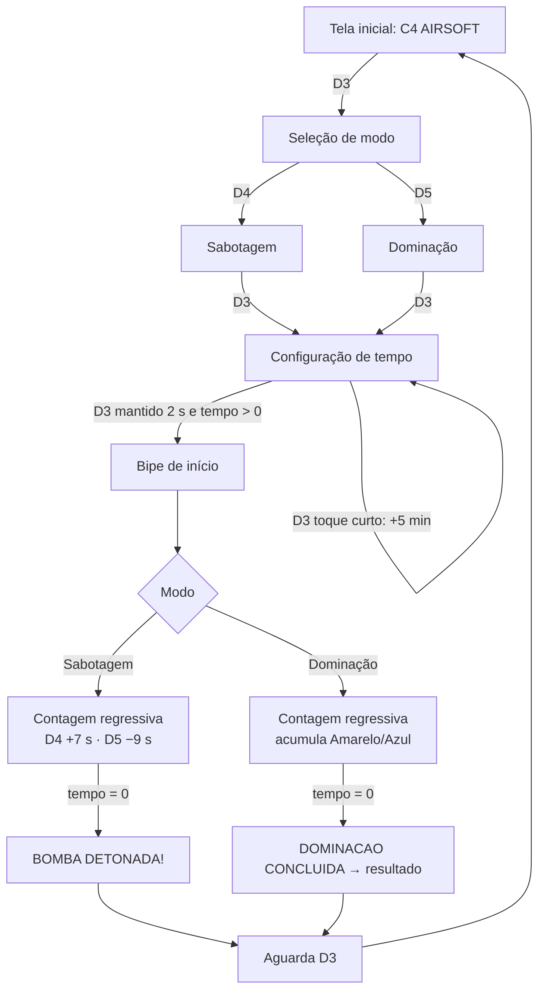

# Arquitetura

## Plataforma

Sistema **embarcado** em Arduino UNO (não é web, mobile ou desktop). O microcontrolador lê comandos físicos, processa as regras localmente e controla o LCD e o buzzer. Não há backend, banco de dados, API ou serviço externo.

## Blocos lógicos

| Bloco | Elementos | Responsabilidade |
|---|---|---|
| Usuário | Organizador / participantes | Comandos e acompanhamento |
| Entradas | Botões D3, D4, D5 | Seleção, confirmação, configuração e comandos de equipe |
| Processamento | Arduino UNO + software | Estados, temporização, interface e regras |
| Saídas | LCD 16x2 I2C e buzzer | Informação visual e sinalização sonora |
| Dinâmica | Sabotagem / Dominação | Lógica específica de cada modo (executada em software) |

```
 Usuário ──► [D3] [D4] [D5] ──► Arduino UNO ──► LCD 16x2 I2C (0x27)
                                 (software)  └─► Buzzer (D6, 959 Hz)
                                     │
                          ┌──────────┴──────────┐
                      Sabotagem             Dominação
```

## Fluxo macro

```
Inicialização → Seleção do modo → Definição do tempo → Execução → Finalização → Reinicialização
```

A confirmação da seleção e a pressão longa para iniciar são **eventos de transição**, não estados independentes.



## Organização do código (`src/C4_Airsoft/C4_Airsoft.ino`)

### Estruturas e variáveis centrais

| Elemento | Função |
|---|---|
| `enum Mode { SABOTAGEM, DOMINACAO }` | Modos de jogo |
| `currentMode` | Modo selecionado |
| `configuredSeconds` | Tempo definido na configuração (0 a 5940 s) |
| `remainingSeconds` | Tempo restante durante a execução |
| `yellowMilliseconds`, `blueMilliseconds` | Acumuladores de domínio por equipe |
| `displayedTeam` | Equipe atualmente exibida (0 neutro, 1 amarelo, 2 azul) |
| `teamHeld` | Equipe com botão exclusivamente pressionado no ciclo atual |

### Rotinas

| Rotina | Responsabilidade |
|---|---|
| `setup()` | Inicializa LCD, pinos e exibe a tela inicial |
| `loop()` | Executa um ciclo completo: seleção → configuração → execução → fim → reinício |
| `lcdLine()` | Escreve uma linha completa de 16 colunas, limpando resíduos |
| `showHome()` / `showMode()` | Telas inicial e de seleção |
| `formatTime()` | Converte segundos em `MM:SS` |
| `showSetup()` / `showSabotagem()` / `showDominacao()` | Telas de configuração e dos modos |
| `beepStart()` / `beepFinish()` | Sinais sonoros (959 Hz) |
| `waitRelease()` | Aguarda soltar o botão + debounce |
| `waitForReset()` | Aguarda novo acionamento de D3 para reiniciar |

### Detalhes de implementação

- **Debounce:** `waitRelease()` aguarda a liberação do botão e espera `DEBOUNCE_MS` (40 ms).
- **Pressão longa:** `millis()` mede o tempo de D3 pressionado; ≥ `HOLD_MS` (2 s) inicia, desde que `configuredSeconds > 0`.
- **Temporização:** `lastSecond` avança de 1000 em 1000 ms, evitando deriva acumulada.
- **Dominação:** a cada iteração, o tempo decorrido desde a última iteração é somado ao acumulador da equipe atualmente exibida; ambos pressionados ou nenhum = Neutro.
- **Sabotagem:** ajuste imediato ao pressionar e repetição a cada `ADJUST_REPEAT_MS` (250 ms); teto de `MAX_SETUP_SECONDS + 59` s.

## Tecnologias

| Categoria | Tecnologia |
|---|---|
| Microcontrolador | Arduino UNO |
| Linguagem | C/C++ para Arduino |
| IDE | Arduino IDE |
| Simulação | Tinkercad Circuits |
| Display | LCD 16x2 I2C, endereço 0x27 |
| Bibliotecas | `Wire.h`, `LiquidCrystal_I2C.h` |
| Entradas | 3 botões com `INPUT_PULLUP` |
| Saída sonora | Buzzer em D6 |
| Diagramas | Draw.io |
