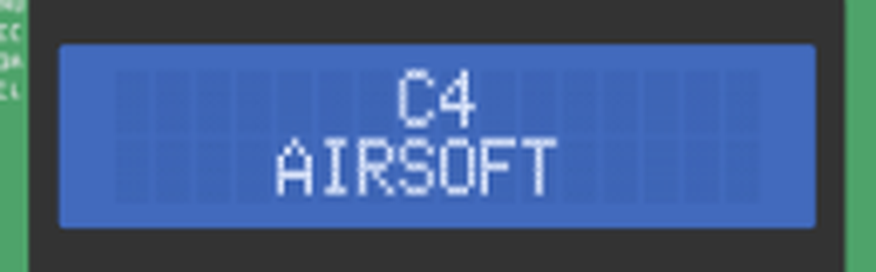
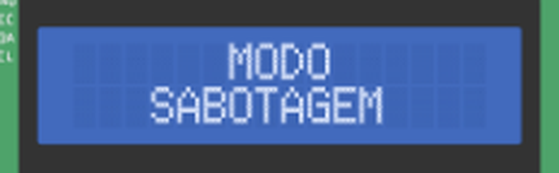
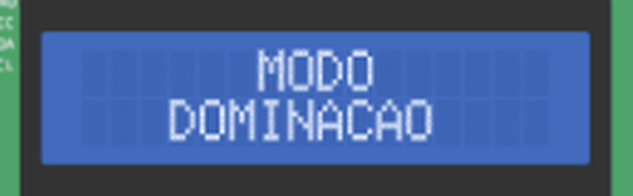
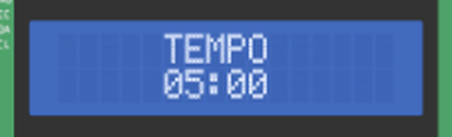
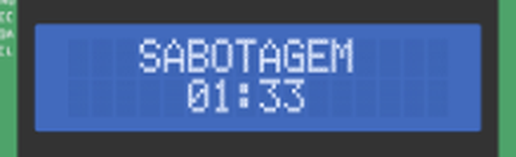
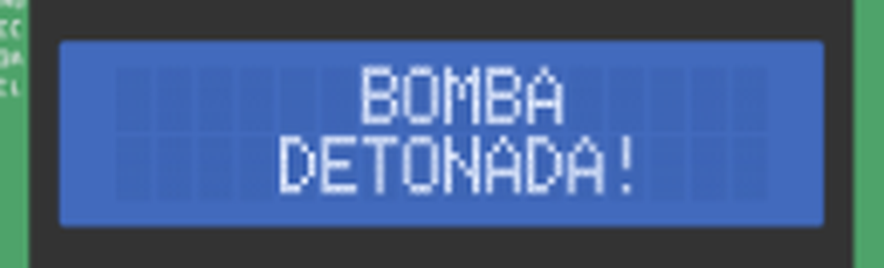
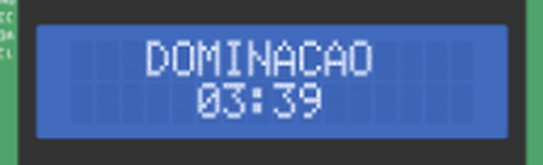
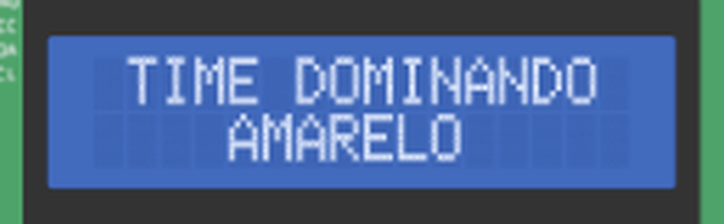
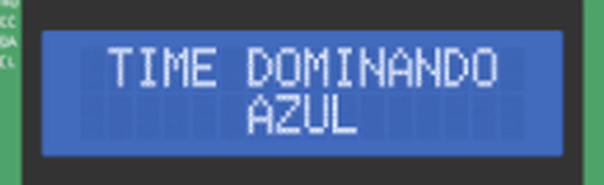
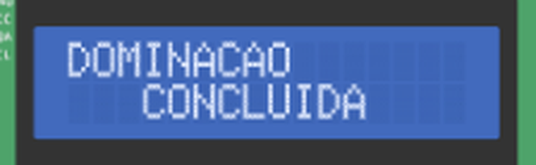

# Qualidade, Testes e Validação

A estratégia associa requisitos a casos de teste e evidências. A simulação no Tinkercad permite observar Arduino, LCD, botões e buzzer. Algumas condições são verificadas por **inspeção de código** quando não há captura visual independente.

## Casos de teste

| Caso | Requisito(s) | Objetivo | Método de verificação |
|---|---|---|---|
| CT01 | RF01 | Inicialização e tela inicial | Simulação |
| CT02 | RF02 / RF06 | Seleção e confirmação do modo | Simulação |
| CT03 | RF03 / RF06 | Configuração comum e incrementos de 5 min | Simulação (a tela TEMPO é comum aos dois modos) |
| CT04 | RF04 / RF05 / RF07 / RF08 | Início da Sabotagem, regressiva e alerta | Simulação |
| CT05 | RF08 | D4 +7 s, D5 −9 s e repetição | Simulação (+7/−9) · inspeção de código (repetição de 250 ms) |
| CT06 | RF05 / RF06 / RF09 | Domínio por botão; liberação/ambos = Neutro | Simulação (um botão por vez) · inspeção de código (simultaneidade e Neutro) |
| CT07 | RF09 | Vitória Amarela, Azul ou empate | Simulação (evidência de empate registrada) |
| CT08 | RF07 | Alertas de 959 Hz | Inspeção de `beepStart()` e `beepFinish()` |
| CT09 | RF10 | Mensagens finais | Simulação |
| CT10 | RF11 | Reinício | Inspeção de `waitForReset()` e retorno a `showHome()` |
| CT11 | RNF01 | Simplicidade | Inspeção |
| CT12 | RNF02 | Modularidade | Inspeção do código |
| CT13 | RNF03 | Expansibilidade | Inspeção do código |
| CT14 | RNF04 | Autonomia do ciclo | Simulação |
| CT15 | RNF05 | Baixa complexidade | Inspeção |
| CT16 | RNF06 | Clareza do LCD | Inspeção das telas |

## Resultado

A versão de trabalho registra **16 casos atendidos**, referentes ao escopo técnico/simulado.

## Evidências

Capturas do Tinkercad (região do LCD), em [`imagens/`](imagens/):

| Casos | Evidência |
|---|---|
| CT01, CT02, CT03 | Inicialização, seleção dos modos e configuração de tempo (comum aos dois modos) |
| CT04, CT09 | Sabotagem em execução e finalização |
| CT06, CT07, CT09 | Dominação: execução, domínio Amarelo/Azul, finalização e resultados |

**Figura 6 – Seleção e configuração**

**Figura 7 – Sabotagem**

**Figura 8 – Dominação**

## Ressalvas

- Capturas do CT05 (08:33→08:40 e 08:40→08:31) demonstram +7 s e −9 s; a repetição a cada 250 ms depende da inspeção do código.
- Capturas do CT06 mostram um botão por vez; simultaneidade e retorno a Neutro são sustentados pelo código.
- CT08 e CT10 foram verificados por inspeção, sem captura dedicada.
- **Não há evidência** de autonomia real, resistência, proteção contra poeira/umidade, alcance sonoro ou efeitos sobre jogadores.
- Não houve protótipo físico nem testes de campo.
